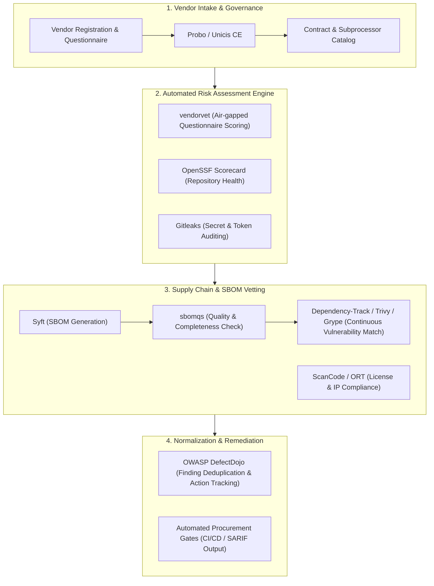

  

  
  
  
  
  
  
  

---

# 🛡️ Awesome Vendor Security Risk Assessment Engines

> **A curated directory of enterprise Third-Party Risk Management (TPRM) platforms, AI-powered security questionnaire engines, cyber rating systems, and open-source software supply chain auditing stacks.**

**Vendor Security Risk Assessment Engines** empower cybersecurity teams, procurement officers, and DevSecOps practitioners to systematically evaluate, score, and continuously monitor the security posture of third-party vendors, SaaS partners, and software suppliers. These systems automate vendor intake questionnaires (SIG, CAIQ, SOC 2, ISO 27001, NIST CSF), perform continuous external attack surface scans, track compliance certifications, and audit software deliverables via Software Bill of Materials (SBOM) and vulnerability cross-referencing.

---

## 📑 Table of Contents

- [🌐 Sector Overview & Market Dynamics](#-sector-overview--market-dynamics)
- [🏢 Enterprise SaaS Platforms Comparison](#-enterprise-saas-platforms-comparison)
- [💻 Open-Source Vendor Assessment & Supply Chain Tools](#-open-source-vendor-assessment--supply-chain-tools)
- [🏗️ Architectural Blueprint for Custom Self-Hosted Stacks](#️-architectural-blueprint-for-custom-self-hosted-stacks)
- [🤝 How to Contribute](#-how-to-contribute)
- [⭐ Star History](#-star-history)
- [💖 Support & Community](#-support--community)
- [⚖️ Disclaimer](#️-disclaimer)

---

## 🌐 Sector Overview & Market Dynamics

The global **Vendor Risk Management (VRM)** and **Third-Party Risk Management (TPRM)** market is valued between **$10 billion and $14 billion in 2025–2026** and is projected to expand beyond **$25 billion to $35 billion by 2032**, compounding at an annual growth rate (**CAGR**) of **12% to 16%**. Market momentum is fueled by a sharp escalation in third-party supply chain data breaches, strict regulatory enforcement across jurisdictions (such as the EU's **DORA**, **NIS2**, and **GDPR**, as well as US **SEC Cyber Incident Disclosure rules**), and the rapid enterprise adoption of AI-accelerated assessment workflows.

The sector exhibits **moderate fragmentation**: while prominent market leaders (such as **BitSight**, **SecurityScorecard**, **OneTrust**, and **UpGuard**) maintain extensive market presence in continuous telemetry ratings and enterprise GRC integrations, the market resists a winner-take-all monopoly. Significant market share is actively captured by specialized innovators focusing on **generative AI questionnaire completion**, **shared vendor risk exchanges**, and **open-source SBOM and supply chain auditing frameworks** that eliminate recurring per-vendor SaaS license fees.

---

## 🏢 Enterprise SaaS Platforms Comparison

The following table benchmarks category-leading commercial vendor security risk assessment platforms, sorted in **descending order by company size** (market capitalization, enterprise valuation, or annual revenue).

| 🏢 Platform / Vendor | 📊 Company Size (Valuation / Revenue) | 💵 Starting Tier Pricing | 🎁 Free Tier / Free Trial Limits | 🔍 Key Capabilities & TPRM Focus |
| :--- | :--- | :--- | :--- | :--- |
| **[RiskRecon](https://www.riskrecon.com/)** *(Mastercard)* | **~$450B+ Market Cap** / **$28B+ Annual Revenue** *(Acquired unit for ~$100M+)* | **$10,000 / year** *(Entry vendor portfolio monitoring package)* | **30-day free trial** with full ratings & telemetry for up to **50 vendors** + own organization assessment report; perpetual **"Know Your Rating"** free plan for self-monitoring | Non-invasive external attack surface analytics across 40+ security criteria, automated vendor issue prioritization matrix, and actionable remediation tracking. |
| **[OneTrust TPRM](https://www.onetrust.com/)** | **$4.5 Billion Valuation** / **~$500M+ ARR** | **$10,000 / year** *(Platform annual contract minimum for core TPRM module)* | **14-day guided proof-of-concept (PoC)** trial with access to industry questionnaire templates (SIG Core/Lite, ISO 27001, NIST) for up to **5 vendors** | Comprehensive TPRM natively integrated into global privacy, compliance, and GRC workflows with automated risk scoring and vendor inventory management. |
| **[BitSight](https://www.bitsight.com/)** | **$2.4 Billion Valuation** / **~$200M+ ARR** | **$18,000 / year** *(SMB / Mid-market entry monitoring subscription)* | **Free-forever Trust Management Hub access** for answering inbound buyer assessments + **1 complimentary cyber risk rating report** for own domain; sales-guided pilot trial | External cybersecurity ratings (250–900 scale), continuous third-party risk monitoring, financial cyber risk quantification, and peer benchmarking. |
| **[SecurityScorecard](https://securityscorecard.com/)** | **~$1.0 Billion Valuation** / **~$144M Annual Revenue** | **$12,000 / year** *(Entry AWS Marketplace / Direct tier for up to 5 fully monitored vendors)* | **Free-forever plan** to view own company score + continuously monitor up to **5 vendor company scorecards**; includes an initial **14-day trial** of paid Business features | A–F security posture rating across 10 risk factor groups, automated questionnaire exchange, third-party breach warning telemetry, and MAX managed services. |
| **[ProcessUnity](https://www.processunity.com/)** *(incl. CyberGRX)* | **~$500 Million Valuation** *(Marlin Equity)* / **~$100M+ ARR** | **$25,000 / year** *(Out-of-the-box SMB starting tier with core templates)* | **Free-forever vendor response access** for third parties updating their Risk Index profiles; **14-day guided sandbox pilot trial** upon sales qualification | Centralized Third-Party Risk Management engine integrated with the Global Risk Exchange for pre-validated cyber assessments and dynamic risk mitigation workflows. |
| **[UpGuard](https://www.upguard.com/)** | **~$400 Million Valuation** / **~$40M–$64M ARR** | **$18,999 / year** *(Starter/Standard tier with 6 seats and up to 50 monitored vendors)* | **Free-forever self-service plan** limited to monitoring up to **5 vendors**; also features a **14-day full platform free trial** *(no credit card required)* | Continuous vendor security ratings based on 330+ external checks, automated questionnaire dispatch/scoring, data leak detection, and external attack surface management. |
| **[Venminder](https://www.venminder.com/)** | **~$250 Million Valuation** *(Ncontracts / Gryphon)* / **~$35M ARR** | **$10,000 / year** *(Modular entry-level subscription for vendor onboarding & contracts)* | **Free registration for Venminder Exchange** to explore control assessments; **14-day structured pilot trial** with sample risk assessments and templates | Dedicated TPRM lifecycle software covering vendor due diligence, automated SLA tracking, contract management, and outsourced SOC review assessments. |
| **[Prevalent](https://www.prevalent.net/)** *(Mitratech)* | **~$150 Million Valuation** *(Parent ~$1B+)* / **~$40M ARR** | **$25,000 / year** *(Tier 1 core TPRM platform package)* | **14-day sales-guided Proof-of-Concept (POC)** pilot trial with evaluation access to active vendor risk scoring workflows and questionnaire templates | Unified TPRM platform integrating automated vendor questionnaire collection, threat intelligence telemetry feeds, risk remediation, and compliance cross-mapping. |
| **[Whistic](https://www.whistic.com/)** | **~$100M–$120 Million Valuation** / **~$15M–$20M ARR** | **$15,500 / year** *(Core TPRM package; £8,500/yr for small 25-assessment bundles)* | **Free-forever Basic Profile** tier (unlimited profile hosting, capped at **3 outbound profile shares/month**); **30-day compliance trial** (10 automated tests) + **5-vendor monitoring trial** | Dual-sided trust center and AI Vendor Summary engine that scans vendor SOC 2 reports and policy PDFs to answer security control questions automatically with citation confidence scores. |
| **[Panorays](https://panorays.com/)** | **~$80M–$100 Million Valuation** / **~$15M ARR** | **$2,500 / year** *(Base tier for small vendor cohorts; median enterprise contract ~$21,700/year)* | **Free-forever Starter Plan** with unlimited duration: inspect own cyber posture, monitor up to **5 third-party vendors**, and issue up to **5 automated security questionnaires** | Third-party cyber posture management combining automated dynamic questionnaires with non-intrusive external attack surface assessments and vendor engagement portals. |

---

## 💻 Open-Source Vendor Assessment & Supply Chain Tools

Open-source tools provide transparent, self-hostable, and air-gapped alternatives to commercial TPRM platforms — eliminating per-vendor pricing while securing source code, dependencies, and container artifacts.

The tools below are **sorted in descending order by GitHub Stars_Count**. Each tool includes a live badge linking directly to its GitHub stargazers page.

---

### 1. [Trivy](https://github.com/aquasecurity/trivy) 
- **License**: Apache-2.0 📄
- **Description**: Comprehensive, multi-faceted security scanner covering container images, filesystems, Git repositories, virtual machine disks, and Kubernetes configurations. Discovers known vulnerabilities (CVEs), hardcoded secrets, misconfigurations, and licenses. Generates and inspects CycloneDX and SPDX Software Bill of Materials (SBOMs), making it an indispensable gate for evaluating third-party vendor software packages.

### 2. [Gitleaks](https://github.com/gitleaks/gitleaks) 
- **License**: MIT 📄
- **Description**: Blazing-fast secret detection engine that scans Git repositories, commits, and directories for hardcoded credentials, API keys, certificates, and auth tokens. Essential during vendor code reviews and third-party software onboarding to ensure suppliers do not introduce exposed secrets into internal infrastructure.

### 3. [Grype](https://github.com/anchore/grype) 
- **License**: Apache-2.0 📄
- **Description**: Dedicated vulnerability scanner for container images and filesystems. Ingests Syft, CycloneDX, and SPDX SBOMs to rapidly identify vulnerabilities in vendor-supplied software artifacts using up-to-date vulnerability feeds (NVD, GHSA, Red Hat, Debian, Ubuntu, Alpine).

### 4. [OSV-Scanner](https://github.com/google/osv-scanner) 
- **License**: Apache-2.0 📄
- **Description**: Google's official vulnerability scanner powered by the Open Source Vulnerabilities (OSV) database. Matches project dependencies, lockfiles, container images, and SBOMs directly against authoritative open vulnerability records with precise version matching, ensuring zero-noise software supply chain auditing.

### 5. [Syft](https://github.com/anchore/syft) 
- **License**: Apache-2.0 📄
- **Description**: CLI tool and library for generating detailed Software Bill of Materials (SBOM) from container images, archives, and directories. Catalogs installed packages, nested transitive dependencies, and license classifications in industry-standard CycloneDX and SPDX formats to verify third-party vendor deliverables.

### 6. [OWASP Dependency-Check](https://github.com/dependency-check/DependencyCheck) 
- **License**: Apache-2.0 📄
- **Description**: Established Software Composition Analysis (SCA) utility that identifies project dependencies and detects known publicly disclosed vulnerabilities (CVEs from NIST NVD). Widely integrated into procurement gates and CI/CD pipelines to audit vendor-submitted source packages.

### 7. [Cosign](https://github.com/sigstore/cosign) 
- **License**: Apache-2.0 📄
- **Description**: Container signing, verification, and storage in an OCI registry (part of Sigstore). Provides cryptographic verification that container images and software artifacts received from third-party vendors are authentic, untampered, and originate from trusted upstream build pipelines.

### 8. [OpenSSF Scorecard](https://github.com/ossf/scorecard) 
- **License**: Apache-2.0 📄
- **Description**: Automated security health metric engine that evaluates open-source dependencies and vendor repositories against 18+ critical supply chain criteria: Branch-Protection, Code-Review, Maintained, Pinned-Dependencies, SAST, Signed-Releases, and Fuzzing. Generates an objective 0–10 risk score for supplier assessment.

### 9. [OWASP DefectDojo](https://github.com/DefectDojo/django-DefectDojo) 
- **License**: BSD-3-Clause 📄
- **Description**: Premier open-source vulnerability management and DevSecOps orchestration platform. Ingests and normalizes audit reports from 150+ security tools (including TPRM scans, container audits, SAST/DAST, and vendor assessments) to deduplicate findings and track vendor vulnerability remediation.

### 10. [Dependency-Track](https://github.com/DependencyTrack/dependency-track) 
- **License**: Apache-2.0 📄
- **Description**: Intelligent Component Analysis platform enabling continuous software supply chain risk management. Consumes CycloneDX and SPDX SBOMs to continuously monitor vendor software components for vulnerabilities (NVD, GitHub Advisories, OSV, VulnDB) and policy violations across entire portfolio assets.

### 11. [ScanCode Toolkit](https://github.com/aboutcode-org/scancode-toolkit) 
- **License**: Apache-2.0 📄
- **Description**: Advanced scanner that discovers licenses, copyrights, package manifests, and dependency origins within codebases. Essential for deep IP provenance auditing, software composition analysis (SCA), and legal risk verification of third-party vendor deliveries.

### 12. [OSS Review Toolkit (ORT)](https://github.com/oss-review-toolkit/ort) 
- **License**: Apache-2.0 📄
- **Description**: Highly configurable compliance pipeline that automates open-source license checks, dependency vulnerability scanning, and organizational policy enforcement. Ingests vendor source trees and outputs curated SBOMs and comprehensive compliance audit reports.

### 13. [CVE Binary Tool](https://github.com/intel/cve-bin-tool) 
- **License**: GPL-3.0 📄
- **Description**: Binary vulnerability inspection tool developed by Intel. Scans compiled vendor binaries, stripped firmware images, and installer packages for known vulnerabilities without requiring access to vendor source code — ideal for black-box procurement verification.

### 14. [Probo](https://github.com/getprobo/probo) 
- **License**: ISC 📄
- **Description**: Modern, self-hostable Governance, Risk, and Compliance (GRC) and Vendor Risk Management platform. Features automated vendor inventory, website risk evaluation, DPA/BAA contract tracking, subprocessor discovery, and 270+ Model Context Protocol (MCP) tools for autonomous AI agent security operations.

### 15. [safedep/vet](https://github.com/safedep/vet) 
- **License**: Apache-2.0 📄
- **Description**: Policy-driven vetting engine for open-source and vendor software dependencies. Evaluates packages for security risk posture, maintainer credibility, malicious injection risks, and licensing compliance using configurable declarative YAML policies.

### 16. [in-toto](https://github.com/in-toto/in-toto) 
- **License**: Apache-2.0 📄
- **Description**: Supply chain cryptographic integrity framework. Enables organizations to define layout policies ensuring each step in a vendor's software development and build pipeline was executed strictly by authorized actors and signed with valid cryptographic keys.

### 17. [Tern](https://github.com/tern-tools/tern) 
- **License**: BSD-2-Clause 📄
- **Description**: Inspection utility and Python library that produces layer-by-layer Software Bill of Materials (SBOM) for container images and Dockerfiles, isolating exactly which dependencies and licenses were introduced by third-party vendor base images.

### 18. [Minefield](https://github.com/bitbomdev/minefield) 
- **License**: Apache-2.0 📄
- **Description**: High-speed SBOM visualization engine that translates intricate Software Bill of Materials into interactive dependency graphs, rapidly highlighting vulnerable transitive packages and single-point-of-failure vendor libraries.

### 19. [Chainloop](https://github.com/chainloop-dev/chainloop) 
- **License**: Apache-2.0 📄
- **Description**: Open-source evidence store and policy engine for software supply chain attestations. Gathers SBOMs, SARIF test outputs, and vendor QA artifacts into cryptographically verifiable attestations, enforcing compliance gates across third-party deliveries.

### 20. [sbomqs](https://github.com/interlynk-io/sbomqs) 
- **License**: Apache-2.0 📄
- **Description**: SBOM quality scoring engine. Evaluates vendor-submitted Software Bill of Materials against NTIA minimum elements, ISO standards, and structural data fidelity to verify that vendor risk audits rely on complete and authentic dependency data.

### 21. [Macaron](https://github.com/oracle/macaron) 
- **License**: UPL-1.0 📄
- **Description**: Supply chain security analysis framework developed by Oracle Labs. Audits vendor repositories and build pipelines against SLSA (Supply chain Levels for Software Artifacts) provenance criteria and automated integrity checks.

### 22. [Unicis Platform CE](https://github.com/UnicisTech/unicis-platform-ce) 
- **License**: AGPL-3.0 📄
- **Description**: Community Edition of the Unicis open-source GRC platform. Maps compliance frameworks (ISO 27001, GDPR, SOC 2, NIST CSF) directly to vendor security profiles and generates automated Statement of Applicability (SoA) reports for third-party audits.

### 23. [XORCISM](https://github.com/XORCISM-AI/XORCISM) 
- **License**: GPL-3.0 📄
- **Description**: Unified, self-hosted cybersecurity platform integrating Third-Party Risk Management (TPRM) with asset management, vulnerability scanning, and SBOM ingestion across 1,100+ security integrations with local AI assistance.

### 24. [OpossumUI](https://github.com/opossum-tool/OpossumUI) 
- **License**: Apache-2.0 📄
- **Description**: Desktop application for auditing and reviewing large codebase scan results from ScanCode and ORT, making third-party vendor license and component compliance reviews efficient and visual.

### 25. [DeltaCode](https://github.com/aboutcode-org/deltacode) 
- **License**: Apache-2.0 📄
- **Description**: Delta audit tool that compares two codebase scans to identify significant modifications in vendor dependencies, license changes, and copyright notices across software release versions.

### 26. [vendorvet](https://github.com/cognis-digital/vendorvet) 
- **License**: MIT 📄
- **Description**: Self-hostable, zero-network vendor risk assessment engine. Automatically scores security questionnaires and cross-references vendor SBOMs against a bundled 262K-record offline OSV/GHSA vulnerability database with zero network leakage. Generates SARIF 2.1.0 and provides an MCP server for AI agent integration.

---

## 🏗️ Architectural Blueprint for Custom Self-Hosted Stacks

Organizations seeking to build an autonomous, zero-cost, self-hosted TPRM stack can combine the following open-source components:

1. **Intake & Governance**: Deploy **Probo** or **Unicis Platform CE** to manage vendor inventories, DPA agreements, and compliance frameworks.
2. **Questionnaire & Health Auditing**: Use **vendorvet** for local questionnaire scoring alongside **OpenSSF Scorecard** for automated Git repository health scoring.
3. **Artifact & SBOM Verification**: Inspect vendor deliverables using **Syft** and **sbomqs**, continuously matching dependencies in **Dependency-Track** and **Trivy**.
4. **Unified Orchestration**: Aggregate and deduplicate findings in **OWASP DefectDojo** to drive vendor remediation tracking and procurement gate enforcement.

---

## 🤝 How to Contribute

We welcome community contributions! To add a new platform, update pricing, or refine capabilities:

1. 🍴 **Fork the repository** on GitHub.
2. 🌿 **Create a dedicated feature branch** (`git checkout -b feature/add-vendor-tool`).
3. 📝 **Add or update the tool entry** in `README.md`:
   - Follow the established table or list format.
   - Include specific pricing, exact free tier limits, verified links, and concise capabilities.
   - For open-source repos, include the Stars_Badge linking to `/stargazers`.
4. 🚀 **Commit and push your changes** (`git commit -m "Add <Tool-Name> to TPRM tools"`).
5. 📬 **Submit a Pull Request (PR)** with a summary of the additions.

---

## ⭐ Star History

---

## 💖 Support & Community

Thank you for visiting and supporting **Awesome Vendor Security Risk Assessment Engines**! If you find this curated resource helpful for your organization's third-party risk management and supply chain security strategy:

- ⭐ **Star this repository** to help other cybersecurity professionals and researchers find it.
- 🍴 **Fork and contribute** to keep entries accurate, comprehensive, and up to date.
- 📢 **Share** with your network across Twitter/X, LinkedIn, and infosec communities.
- ☕ **Sponsor the Project**: If you'd like to support ongoing research and open-source curation, visit the [GitHub Sponsor Dashboard](https://github.com/sponsors/ishandutta2007).

---

## ⚖️ Disclaimer

- This repository is a **community-curated index** created solely for informational, research, and educational purposes. Inclusion does not constitute an endorsement.
- All product names, logos, trademarks, and registered trademarks belong to their respective owners.
- Commercial pricing, tiers, and free trial terms are subject to change by vendors; always consult official vendor documentation for up-to-date commercial terms.
